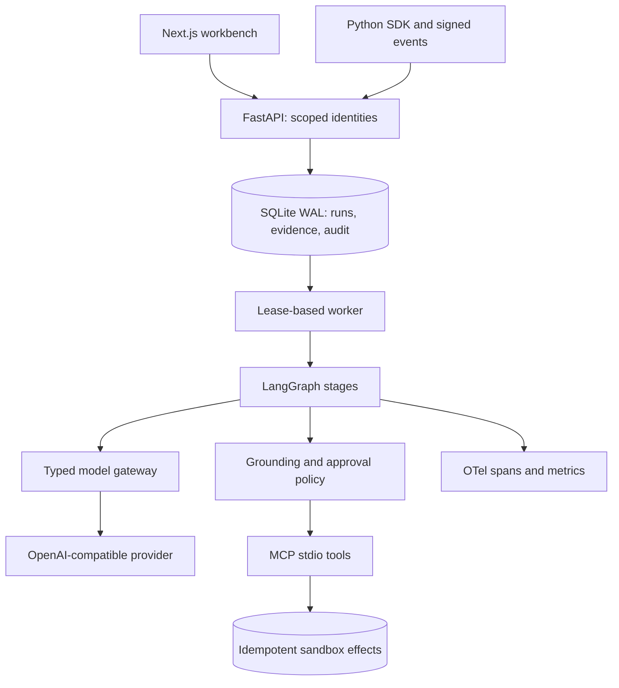

# Executable architecture

## Execution and recovery

Requests create a tenant-scoped run under a required idempotency key. A database uniqueness constraint prevents duplicate enqueueing and rejects reuse with a different body. The worker claims work in `BEGIN IMMEDIATE`, sets a 180-second lease and renews it every 30 seconds. Expired running leases may be reclaimed after a crash. Each completed graph node saves its output; a new runtime reuses saved nodes. Human approval resumes the persisted plan rather than regenerating it.

The effect ledger and its audit event commit in the same SQLite transaction. A retry returns the existing effect. This is a transactionally idempotent **local** side effect, not an exactly-once guarantee for arbitrary external services. Graph stage/audit writes are separate commits; a crash may leave a completed stage without its stage audit event, although tool effect auditing is transactional.

The graph is a bounded, one-action planning cycle. It does not implement open-ended autonomous ReAct loops, a Temporal workflow, or native LangGraph checkpoint storage. Its application-level persisted stage checkpoints are explicit in `runtime.py` and covered by a fresh-runtime resume test.

## Approval and identity

Bearer credentials map server-side to tenant, subject and role. The request cannot choose its own tenant. The operator creates a run; a distinct approver subject may approve a digest binding the run, reflected proposal, evidence and execution mode. The digest is an integrity binding stored by the server, not a public-key signature. Approval expires after one hour and is consumed once. Changed/stale digests, wrong tenants and creator self-approval are denied.

The private MCP process receives tenant and run scope through a minimal environment. It never receives the model API key. Tool arguments cannot select another tenant, run, executable or filesystem path. Side-effect tools repeat authorization from persisted state. Local database access is a trusted administrative boundary.

## Retrieval and model behavior

FTS5 ranks tenant-filtered evidence by BM25. Only retrieved sources are eligible citations; policy verifies source identity and literal quotation. The live gateway calls primary/fallback models with typed response schemas; Pydantic rejects unrecognized fields and unsupported actions. Cache identity includes tenant, endpoint, models, schema, role, prompt and evidence. Entries expire after one hour.

The budget reserves conservative byte-based input estimates plus the output cap **before each request**, including retries. Reservations are persisted and not refunded. It is a coarse token limiter, not a financial spending cap or an exact tokenizer. Add provider-specific token accounting and price tables before offering billing guarantees.

Planner, critic and reflector are three role-separated calls. Critic rejection blocks execution. The reflector can revise a proposal, but cannot override hard tool policy or supply its own approval. Input instructions and retrieved text remain untrusted, with security enforced outside the model.

## Telemetry and storage boundaries

Stage spans carry a run ID and timing, not raw prompts or documents. Set `OTEL_EXPORTER_OTLP_ENDPOINT` to use an external OTLP/HTTP collector. `/metrics` requires an admin key and uses bounded scenario/stage labels. Stored run/evidence data is plaintext on the local volume; host encryption, retention, secure backup and deletion procedures are operator responsibilities.

No vector search, OIDC, PostgreSQL RLS, distributed workers, managed cloud actions, Langfuse backend or cloud deployment is implied by this implementation. Those remain in the [release gate document](PRODUCTION.md).
